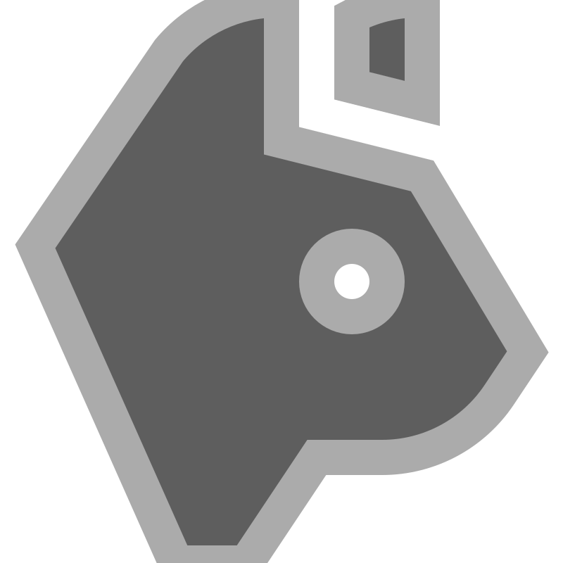

# MyWall

<div align="center">
    
    <br>
    <h3>A corkboard for people who don't trust Google Docs.</h3>

[](LICENSE)
[](https://www.php.net/downloads)

</div>

> "What if Pinterest, but it's just sticky notes, and also I wrote my own PHP framework for some reason."

## What even is this?

`mywall` is a personal pinboard. You sign up, you get your own infinite wall, and you can pin little index-card notes to it — drag them around, zoom in and out, write your deepest thoughts in 20-character titles. Anyone can visit `yourusername` and admire your wall, but only you can rearrange the furniture.

It's basically a physical corkboard, except digital, except it's held together by `hex2bin()` calls and vibes.

## The stack (a.k.a. "why is there a whole framework in `vendor/`")

- **Backend:** PHP, running on top of a homemade micro-framework called **Indura** (`davidleonstr/indura`), which handles routing, views, layouts, JSON responses and something else.
- **Database:** MySQL, hosted on some place, storing `accounts` and `cards` as `BINARY(16)` UUIDs because regular auto-increment IDs are for cowards.
- **Frontend:** Vanilla JS. No React, no build step, no `node_modules` — just `pointerdown`/`pointermove` events and raw willpower to make cards draggable, pinchable, and zoomable.
- **Auth:** Username + password, stored and compared directly. (See [Security](#-security-a-love-letter), below.)

## Features

- **Personal walls** — every account gets a corkboard at `/yourusername`.
- **Draggable sticky-note cards** — double-click (or double-tap) to spawn one, drag to reposition, click the floppy disk to save.
- **Pan & zoom** — mouse wheel, buttons, or pinch-to-zoom on mobile, like Google Maps but for your grocery list.
- **Accounts** — sign up, sign in, and your ID gets stashed in `localStorage` like it's 2012.
- **Ownership rules** — you can only edit or delete your own cards. Other people's cards are read-only, so no vandalizing your friend's wall (the API might disagree, see below) (You can do it if you have root access on your account.).

## Running it locally

```bash
composer install     # pulls in Indura, the tiny framework doing the heavy lifting
vendor/bin/indura/ serve   # or just:
php -S localhost:8000 -t public
```

Then visit `http://localhost:8000`, make an account, and start pinning your feelings to the internet.

## Security (a love letter)

This project was built for fun, and it shows its work:

- Passwords are stored and compared **in plain text**. If you use your real password here, that's between you and your therapist.
- Database credentials are checked directly into `app/constants/database.php`. Yes, including the actual host, port, and password. (Maybe not on GitHub).
- Ownership checks on cards happen mostly client-side, and the card API trusts whatever account_id you hand it — so with a little curl-fu, you could probably edit anyone's sticky notes; the only thing saving you is the `auth_key`.
- SQL queries are parameterized (good!) but the authentication logic has a few `if/else` branches that look like they were reasoned about at 3 AM (relatable).

**tl;dr: do not deploy this with real user data.** Deploy it with fake data, your favorite quotes, or ASCII art of a cat. That's what it's for.

## Project structure

```
app/
  helpers/       # Utilities for encrypting things and the like
  controllers/   # the actual logic (auth, cards, account lookup)
  constants/     # Things that you need to change in production
  views/         # thin wrappers that require() the controllers
  layouts/       # HTML shells (main, wall, controller/JSON)
  database/      # PDO connection setup
public/
  index.php      # entrypoint
  src/           # css/js for the login screen and the wall
vendor/
  davidleonstr/indura/   # the homemade framework doing the routing
dev/
  schema.sql     # the two whole tables this app needs
```

## Why "Indura"?

[GitHub Project](https://github.com/davidleonstr/indura)

No idea. But it has its own CLI, its own docs site, and a `help` command, which is more effort than most people put into apps that actually make money. Respect.

> That microframework won a local hackathon, by the way. Perhaps because it was the best thing out there, not because it was actually good.

## License

Do whatever you want with it. Pin it to your own wall.